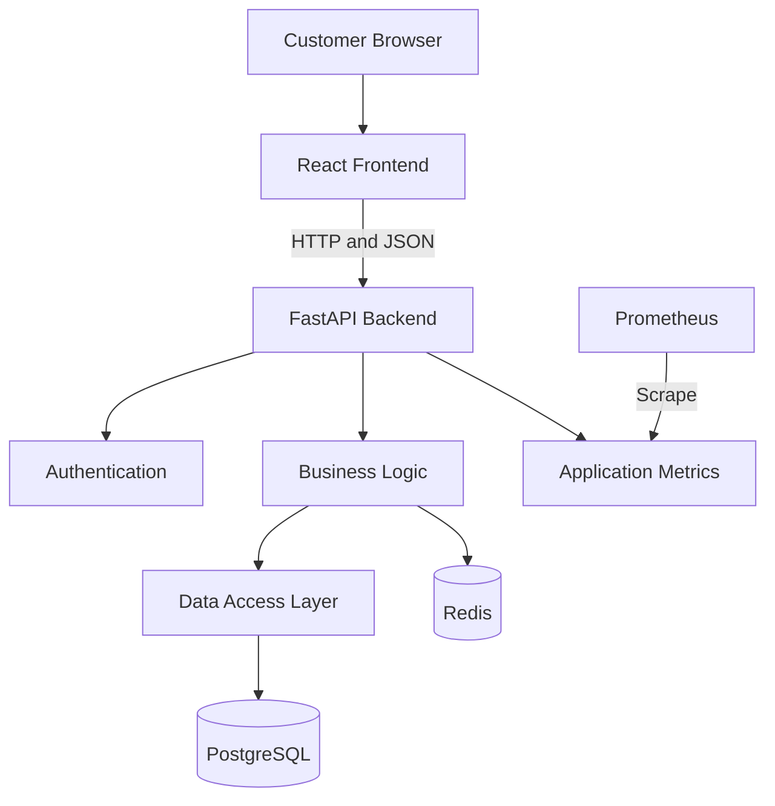

# AgriCommerce | Application Services

Application engineering and continuous integration for the
AgriCommerce Kubernetes Progressive Delivery Platform.


## Overview

AgriCommerce is a simulated agricultural e-commerce
application designed to support production-style Kubernetes
engineering and progressive delivery exercises.

This repository owns the application source code, automated
tests, database migrations, container images and continuous
integration workflows.

The application provides a realistic workload for validating
Blue-Green deployments, GitOps, scalability, observability,
security and disaster recovery.

## Platform Portfolio

The complete platform architecture, engineering objectives,
architectural decisions and validation evidence are maintained
in the central portfolio repository:

[AgriCommerce Platform](https://github.com/Oluadepe/agricommerce-platform)

## Project Status

Active development.

The architecture and capabilities described below represent
the target implementation.

Verified results will be published as development progresses.

## Application Architecture




### Detailed Application Design

The detailed application design documents the business
requirements, application architecture, user journeys,
request lifecycle, database relationships, API contracts,
security requirements and Blue-Green release behaviour.

[Read the AgriCommerce Application Concept and Architecture](docs/architecture/APPLICATION-DESIGN.md)


## Functional Scope

- Product catalogue.
- Inventory management.
- Customer order processing.
- Authentication and authorization.
- Transactional data integrity.
- Application caching.
- Application health endpoints.
- Release version identification.
- Structured logging and application metrics.

## Technology Stack

| Technology | Responsibility |
|---|---|
| React | Customer-facing frontend |
| FastAPI | Backend REST API |
| PostgreSQL | Persistent transactional data |
| Redis | Application caching |
| SQLAlchemy | Database access |
| Alembic | Database schema migrations |
| Pytest | Automated backend testing |
| Nginx | Frontend asset serving and reverse proxy |
| Docker | Reproducible container images |
| GitHub Actions | Continuous integration |
| GHCR | Container artifact distribution |

## Planned Repository Structure

```text
agricommerce-app/
├── frontend/
├── backend/
├── tests/
├── scripts/
├── docs/
├── .github/
│   └── workflows/
├── .gitignore
└── README.md
```

## Continuous Integration

The planned continuous integration pipeline will:

1. Validate source code.
2. Execute unit and integration tests.
3. Scan application dependencies.
4. Build application container images.
5. Scan container images.
6. Generate software bills of materials.
7. Publish approved images to GHCR.
8. Propose immutable image references in the GitOps repository.

The application CI pipeline will not require direct
administrative access to the Kubernetes cluster.

## Deployment Strategy

Application artifacts will be deployed through the
AgriCommerce GitOps repository using Helm, Argo CD and
Argo Rollouts.

The application will support concurrent release revisions
during Blue-Green deployment.

Database changes will follow backward-compatible
expand-and-contract migration principles.

## Reliability Requirements

- Graceful application termination.
- Meaningful readiness and liveness checks.
- Stateless application containers where appropriate.
- Backward-compatible API changes.
- Safe database transactions.
- Configurable resource consumption.
- Structured logs and application metrics.
- Immutable application release identification.

## Development Roadmap

- [ ] Establish application repository governance.
- [ ] Configure Python development environment.
- [ ] Implement backend API foundation.
- [ ] Implement application health endpoints.
- [ ] Integrate PostgreSQL.
- [ ] Implement database migrations.
- [ ] Implement product and inventory APIs.
- [ ] Implement order processing.
- [ ] Integrate Redis.
- [ ] Implement authentication and authorization.
- [ ] Build React frontend.
- [ ] Implement automated tests.
- [ ] Containerize application components.
- [ ] Implement continuous integration.
- [ ] Integrate application release workflow.

## Security

Credentials, access tokens, database passwords and
environment-specific secrets must never be committed.

Application security controls and vulnerability scanning
will be introduced and validated throughout implementation.

## Author

Olusegun Mayungbe

Part of the AgriCommerce Kubernetes Progressive Delivery
Platform engineering portfolio.
