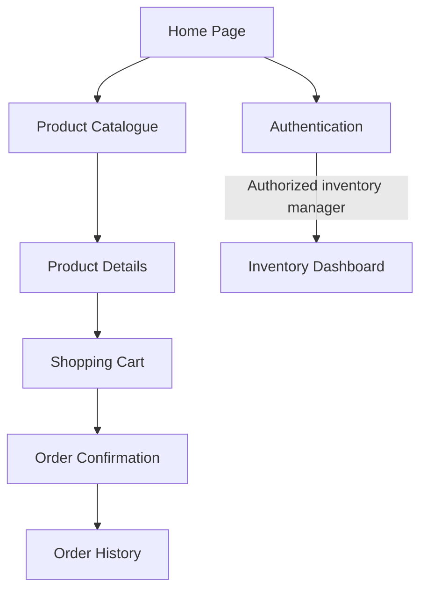
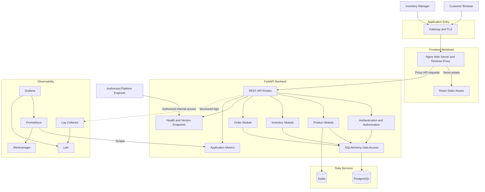
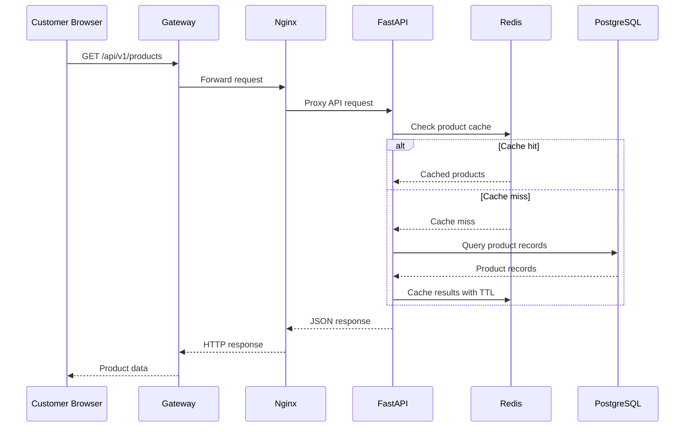
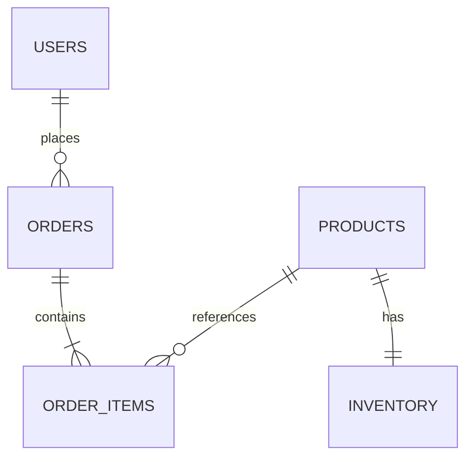
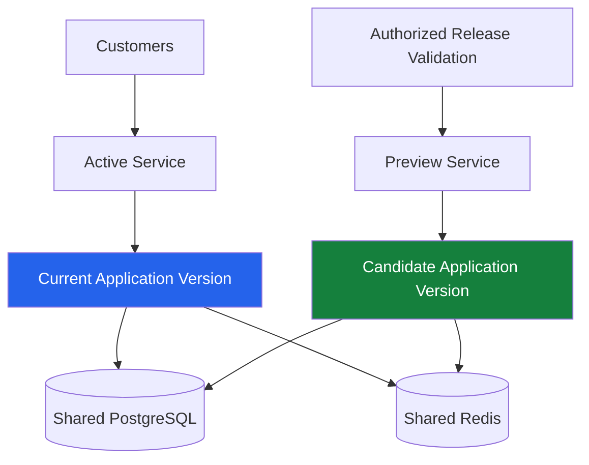

# AgriCommerce Application Concept and Architecture

## Document Information

| Property | Value |
|---|---|
| Document | Application Design |
| Version | 1.0 |
| Date | 2026-11-25 |
| Status | Proposed Architecture |
| Owner | Application Engineering |
| Author | Olusegun Mayungbe |

## 1. Application Concept

AgriCommerce is a simulated agricultural marketplace
connecting customers with agricultural produce through
a cloud-native web application.

The application provides a realistic business workload
for demonstrating Kubernetes administration, progressive
delivery, infrastructure automation, DevSecOps, Site
Reliability Engineering and disaster recovery.

The objective is not to build a complete commercial
marketplace, but to implement sufficient business
functionality to validate production-style engineering
capabilities.

## 2. Business Objectives

- Provide access to an agricultural product catalogue.
- Support product inventory management.
- Enable customer order processing.
- Maintain transactional data integrity.
- Provide reliable application access during deployments.
- Support controlled application upgrades and rollback.
- Enable measurable application performance monitoring.
- Demonstrate secure and recoverable application operations.

## 3. Application Users

| User | Responsibility |
|---|---|
| Customer | Browse products and place orders |
| Inventory Manager | Manage products, prices and stock |
| Administrator | Manage authorized application operations |
| Platform Engineer | Deploy, monitor and troubleshoot services |

Application user roles are separate from Kubernetes
administrative roles.

## 4. Functional Requirements

| ID | Module | Requirement |
|---|---|---|
| FR-001 | Products | Browse and retrieve agricultural products |
| FR-002 | Inventory | Track available product quantities |
| FR-003 | Orders | Create and retrieve customer orders |
| FR-004 | Transactions | Maintain order and inventory consistency |
| FR-005 | Users | Authenticate application users |
| FR-006 | Authorization | Enforce application role permissions |
| FR-007 | Cache | Cache frequently requested product information |
| FR-008 | Health | Expose application health endpoints |
| FR-009 | Releases | Expose application release identifiers |
| FR-010 | Observability | Provide structured logs and metrics |
| FR-011 | Testing | Support restricted failure simulation |

Failure simulation must be disabled in the simulated
production environment or restricted to authorized
isolated testing environments.

## 5. Application User Interface

The React frontend will initially contain:

- Home page.
- Product catalogue.
- Product details.
- Shopping cart.
- Customer order history.
- Inventory management dashboard.
- Authentication interface.
- Application release information.

Example demonstration data:

| Product | Unit Price | Available Quantity |
|---|---|---|
| Maize | NGN 850/kg | 120 kg |
| Tomatoes | NGN 1,200/kg | 80 kg |
| Rice | NGN 1,500/kg | 250 kg |

All initial product records represent synthetic test data.

### Navigation Concept



## 6. Application Architecture

The application adopts a modular backend architecture
with independently deployable frontend and backend
components.

A modular backend reduces initial development and
operational complexity while preserving clear boundaries
between business capabilities.



The diagram represents the target logical architecture.
The final Gateway implementation and deployment routing
will be validated during Kubernetes integration.

## 7. Component Responsibilities

| Component | Responsibility |
|---|---|
| React | Browser-based application interface |
| Nginx | Serve frontend assets and proxy API requests |
| FastAPI | HTTP API and application business logic |
| SQLAlchemy | Database access and connection management |
| Alembic | Version-controlled database schema migrations |
| PostgreSQL | Persistent application records and transactions |
| Redis | Temporary product catalogue caching |
| Pytest | Automated backend and integration tests |
| Prometheus | Application and platform metrics |
| Grafana | Operational dashboards |
| Loki | Centralized log storage |
| Alertmanager | Alert routing and notifications |

## 8. Request Lifecycle

A typical product request follows this sequence:



The browser renders the returned product information
through the React application.

## 9. Data Architecture

PostgreSQL will be the authoritative source of
application data.

Initial data entities:

- Users.
- Products.
- Inventory records.
- Orders.
- Order items.



Order creation and inventory deduction must occur
within a consistent database transaction.

Concurrent order requests must not result in negative
inventory or duplicate committed orders.

Redis will not be the authoritative source of inventory
or order information.

Product cache entries will use bounded expiration and
an appropriate invalidation strategy.

Cache failures should allow product requests to fall
back to PostgreSQL where safe and within capacity limits.

Detailed schemas and migration strategies will be
documented during database implementation.

## 10. Proposed API Contract

| Method | Endpoint | Responsibility |
|---|---|---|
| GET | /api/v1/products | Retrieve products |
| GET | /api/v1/products/{id} | Retrieve a specific product |
| POST | /api/v1/products | Create an authorized product |
| GET | /api/v1/inventory | Retrieve authorized inventory data |
| PATCH | /api/v1/inventory/{id} | Update inventory |
| POST | /api/v1/orders | Create customer order |
| GET | /api/v1/orders | Retrieve authorized orders |
| POST | /api/v1/auth/login | Authenticate user |
| GET | /health/live | Check process health |
| GET | /health/ready | Check readiness to accept traffic |
| GET | /health/startup | Check initialization |
| GET | /version | Return application release information |
| GET | /metrics | Expose operational metrics |

The API contract is provisional and will be refined
during implementation.

Operational endpoints must not expose sensitive
configuration or internal credentials.

Metrics access will be restricted to authorized
monitoring clients.

## 11. Application Health Model

### Liveness

Determine whether the application process is functioning.

Temporary database or cache failures must not cause
unnecessary application restart loops.

### Readiness

Determine whether the application can accept requests
according to its essential dependency requirements.

PostgreSQL connectivity will be considered when
validating transactional API readiness.

Redis unavailability will not automatically make the
application unready when safe fallback is possible.

### Startup

Determine whether application initialization has completed.

Startup checks will prevent premature liveness failures
during application initialization.

## 12. Release Identification

Each application build will expose release information.

Example:

```json
{
  "application": "agricommerce-api",
  "version": "1.0.0",
  "commit": "example-commit"
}
```

The values above are illustrative.

Release metadata will be derived from the build
and release process.

Blue and Green represent deployment roles rather than
permanent application version identifiers.

## 13. Blue-Green Release Behaviour

The application must support the concurrent operation
of compatible release revisions.



This is a logical release diagram. Frontend and backend
workloads may have separate rollout resources.

Their routing, API compatibility and promotion ordering
must be designed and validated during GitOps integration.

Both releases must support compatible database schemas
and cache formats throughout the transition.

Database migrations will follow expand-and-contract
principles.

Application rollback does not automatically reverse
database migrations or committed business transactions.

## 14. Non-Functional Requirements

| Category | Requirement |
|---|---|
| Availability | Target 99.9% over a defined measurement window |
| Deployment | Zero observed downtime during controlled promotion |
| Performance | API P95 latency below 300 ms under defined normal load |
| Rollback | Target below 60 seconds with previous revision available |
| Security | Least privilege and restricted access |
| Scalability | Independently scalable stateless workloads |
| Reliability | Graceful termination and meaningful health checks |
| Recoverability | Tested backup and restoration procedures |
| Observability | Structured logs, metrics and release identification |
| Data Integrity | No lost committed transactions during validated exercises |

These requirements are engineering targets.

Actual results and test conditions will be documented
after implementation.

## 15. Security Requirements

- Store passwords using appropriate password hashing.
- Enforce application authorization on the backend.
- Validate incoming API requests.
- Prevent unauthorized access to customer orders.
- Keep database and cache services private.
- Restrict access to operational endpoints.
- Never commit credentials or secret values.
- Use non-root containers where applicable.
- Protect external application traffic using TLS.
- Scan application dependencies and container images.
- Restrict test-only failure simulation functionality.

## 16. Application Engineering Scenarios

| Scenario | Application Capability Required |
|---|---|
| Blue-Green deployment | Distinguishable application releases |
| Automated rollback | Health indicators and measurable errors |
| Kubernetes cluster upgrade | Continuous request and transaction processing |
| Worker node failure | Distributed stateless application replicas |
| Database failure | Controlled connection handling and recovery |
| Redis failure | Safe database fallback |
| Database migration | Backward-compatible schema changes |
| CPU exhaustion | Metrics and controlled load generation |
| Application latency | Request duration metrics |
| Authorization failure | Protected application operations |
| Disaster recovery | Persistent data backup and restoration |

These scenarios connect application implementation
to the operational exercises defined in the central
AgriCommerce platform portfolio.

## 17. Implementation Sequence

1. Configure the Python development environment.
2. Implement the FastAPI application foundation.
3. Implement health and release endpoints.
4. Establish automated backend testing.
5. Integrate PostgreSQL and SQLAlchemy.
6. Establish Alembic database migrations.
7. Implement product and inventory management.
8. Implement transactional order processing.
9. Integrate Redis caching.
10. Implement authentication and authorization.
11. Build the React frontend.
12. Integrate frontend and backend services.
13. Implement structured logging and metrics.
14. Containerize frontend and backend workloads.
15. Establish continuous integration.

## 18. Scope Boundaries

The initial project excludes:

- Real payment processing.
- Real customer financial information.
- Commercial delivery and logistics integrations.
- Multi-region application deployment.
- Unnecessary microservice decomposition.

These capabilities may be considered as future
extensions after the core platform has been validated.

## 19. Validation Strategy

Application implementation will be evaluated through
unit tests, integration tests, API validation,
concurrency testing and performance exercises.

Operational capabilities will be evaluated through
controlled Kubernetes deployments, failure simulations,
release promotion, rollback and disaster recovery.

No production-readiness or availability claims will
be made before supporting evidence is collected.

## 20. Related Documentation

- [Application Repository README](../../README.md)
- [Central Platform Portfolio](https://github.com/Oluadepe/agricommerce-platform)
- [ADR-001 Infrastructure Selection](https://github.com/Oluadepe/agricommerce-platform/blob/main/docs/adr/ADR-001-infrastructure-selection.md)
- [OPS-001 Kubernetes Cluster Upgrade](https://github.com/Oluadepe/agricommerce-platform/blob/main/docs/scenarios/OPS-001-kubernetes-cluster-upgrade.md)
